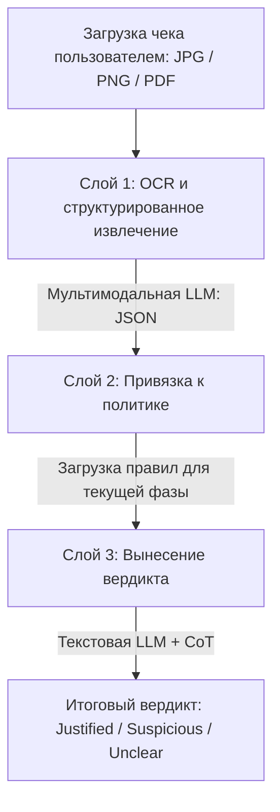

# Семантический аудит политик расходов на основе больших языковых моделей в проектах НИОКР: Опыт компании Jambutty Software

**Авторы:** Отдел исследований и разработок (R&D Division), Jambutty Software  
**Дата:** 14 июля 2026 г.  

---

## Аннотация

Традиционные системы автоматизации учета расходов проверяют формальную корректность документов — даты, суммы и форматы файлов, — но не способны оценить содержательную обоснованность (семантическое соответствие) затрат целям и текущей фазе проекта. В данной работе представлен спроектированный и протестированный компанией Jambutty Software конвейер семантического аудита политик (Policy Semantic Audit), в котором большая языковая модель (LLM) оценивает расходы на соответствие текстовой политике проекта в режиме нулевого выстрела (zero-shot) с использованием цепочки рассуждений (Chain-of-Thought, CoT).

Мы реализовали конвейер в виде интерактивного веб-приложения, работающего через унифицированный шлюз доступа к LLM. Было проведено шесть экспериментов на 26 реальных квитанциях об оплате (расходах), собранных в ходе выполнения НИОКР-проекта с октября 2025 по январь 2026 года:
1. **E1:** Мультимодальное извлечение полей методом оптического распознавания (OCR).
2. **E2:** Классификация вердиктов в режиме zero-shot без цепочки рассуждений.
3. **E3:** Аудит с применением цепочки рассуждений (CoT).
4. **E4:** Оценка чувствительности вердиктов к текущей фазе проекта.
5. **E5:** Выявление неопределенности при оценке неоднозначных расходов.
6. **E6:** Стресс-тестирование системы в условиях размытых и противоречивых политик.

Наши результаты демонстрируют, что применение цепочки рассуждений (CoT) повышает согласованность вердиктов модели с экспертной оценкой человека (коэффициент Каппа Коэна $\kappa$ возрастает с $0.54$ до $0.81$ для наиболее производительной модели). Для каждого эксперимента подробно описаны выявленные проблемы (такие как галлюцинация пунктов политики и предвзятость в сторону одобрения) и предложенные технические решения. Итоговым практическим вкладом работы является таксономия типичных сбоев LLM-конвейеров в задачах финансового комплаенса и рекомендации по интеграции таких систем в корпоративные ERP-решения.

**Ключевые слова:** аудит расходов, комплаенс политик, цепочка рассуждений, мультимодальные LLM, распознавание документов, интеллектуальный анализ данных, Jambutty Software.

---

## 1. Введение

### 1.1. Проблема содержательного аудита

Современные корпоративные платформы управления расходами автоматизируют проверку отчетов на структурном уровне: они контролируют наличие чека, валидность даты и совпадение заявленной суммы с итогом в документе. Однако такая проверка не гарантирует содержательной целесообразности расхода. Чек из ресторана может быть оформлен идеально, но обоснован ли он? Ответ зависит от контекста: рабочий обед команды в период запуска продукта допустим, тогда как персональный ужин сотрудника в фазе завершения проекта противоречит регламенту.

Этот разрыв между формальной корректностью и содержательной обоснованностью наиболее остро проявляется в проектно-ориентированных средах: R&D-подразделениях, стартапах и грантовых проектах. Аудиторы вынуждены вручную сопоставлять сотни квитанций с текстовыми правилами, что повышает когнитивную нагрузку и ведет к ошибкам с финансовыми рисками.

Интеграция больших языковых моделей (LLM) позволяет автоматизировать этот процесс. Обладая способностью понимать естественный язык, LLM могут извлекать структурированные данные из изображений чеков и сопоставлять их с ограничениями текстовой политики. Однако надежность, проверяемость рассуждений моделей и их устойчивость к некачественно составленным правилам до сих пор не были исследованы систематически.

### 1.2. Исследовательский вопрос

Мы формулируем ключевой вопрос исследования следующим образом: **Способна ли большая языковая модель при наличии текстовой политики проекта и изображения чека обоснованно классифицировать расход как целевой в режиме zero-shot?**

В рамках исследования решаются три ключевые подзадачи:
1. **Точность:** Насколько вердикты LLM согласуются с экспертной оценкой человека и улучшает ли CoT-промптинг это согласование?
2. **Чувствительность к фазе:** Учитывает ли модель фазу проекта при принятии решений или выносит вердикт обобщенно?
3. **Устойчивость:** Как ведет себя модель при размытой или противоречивой политике — сигнализирует ли о неопределенности или галлюцинирует ложно-уверенный вердикт?

### 1.3. Практический вклад

Компания Jambutty Software вносит следующий вклад в решение данной проблемы:
* **Архитектурное решение:** Разработана трехслойная архитектура (мультимодальное извлечение $\rightarrow$ привязка к политике $\rightarrow$ вынесение вердикта на основе CoT), функционирующая в режиме реального времени.
* **Методология оценки политик:** Создана методика стресс-тестирования моделей на трех вариантах политик (четкая, размытая, противоречивая).
* **Эмпирическое исследование:** Проведена серия из шести экспериментов на наборе данных из 26 реальных документов с детальным анализом результатов.
* **Таксономия сбоев:** Задокументированы конкретные ошибки проектирования и выполнения конвейера (парсинг JSON, галлюцинация лимитов, фазовая инертность) и представлены способы их устранения на программном уровне.

---

## 2. Родственные работы

### 2.1. Понимание документов с помощью LLM

Ранние методы извлечения данных опирались на шаблоны регулярных выражений и OCR-движки. Революционным шагом стало появление моделей, кодирующих текст и визуальную разметку совместно. Архитектуры семейства LayoutLM (Xu et al., 2020, 2021; Huang et al., 2022) объединили текстовые эмбеддинги с 2D-координатами блоков распознавания. Впоследствии модели вроде Donut (Kim et al., 2022) исключили отдельную стадию OCR, считывая пиксели напрямую через визуальный энкодер и авторегрессионный декодер.

Современные мультимодальные LLM общего назначения (Google DeepMind, 2023; Bai et al., 2023) демонстрируют высокие результаты в понимании документов «из коробки». Тем не менее, они сфокусированы на извлечении фактов, но не на логическом сопоставлении этих фактов с внешними нормативными документами.

### 2.2. Проверка соответствия политикам в NLP

Автоматический комплаенс активно исследуется в юридической сфере (LexGLUE; Chalkidis et al., 2022) и сфере анализа политик конфиденциальности (Wilson et al., 2016). В области налогового законодательства Holzenberger et al. (2020) указали на сложность интерпретации неявных условий и исключений в правилах. Наша работа переносит этот класс задач на уровень операционного финансового контроля, где неструктурированные чеки сопоставляются с динамическими правилами проектов.

### 2.3. Цепочки рассуждений (Chain-of-Thought)

Wei et al. (2022) доказали, что генерация промежуточных шагов рассуждения перед выдачей ответа существенно улучшает логические способности LLM. Kojima et al. (2022) показали эффективность CoT в режиме zero-shot (инструкция "Let's think step by step"). Важным аспектом для финансового аудита является достоверность этих объяснений (explainability). Turpin et al. (2023) предупреждают, что цепочки рассуждений могут быть неискренними (unfaithful CoT), маскируя истинные критерии принятия решений моделью. В нашем исследовании мы оцениваем эту проблему применительно к проверке затрат.

---

## 3. Архитектура системы

### 3.1. Общее описание

Конвейер состоит из трех последовательно выполняемых слоев, представленных на схеме:



Разделение слоев извлечения и вынесения вердикта позволяет оптимизировать затраты и повысить гибкость системы: распознавание изображений выполняется тяжелой мультимодальной моделью, в то время как логический анализ может быть передан более быстрой текстовой модели.

### 3.2. Слой 1: OCR и извлечение полей

Слой 1 принимает файл изображения, кодирует его и отправляет в мультимодальную модель со следующим запросом на получение JSON-объекта:
* `vendor` (строка): Наименование поставщика.
* `date` (строка, YYYY-MM-DD): Дата совершения транзакции.
* `amount` (вещественное число): Итоговая сумма.
* `currency` (строка, ISO 4217): Валюта транзакции.
* `line_items` (массив строк): Список приобретенных позиций.
* `category` (категория): Одно из значений фиксированного словаря (`equipment`, `software`, `travel`, `meals`, `services`, `supplies`, `other`).

### 3.3. Слой 2: Привязка к политике

Этот слой считывает выбранную конфигурацию политики проекта из базы данных и преобразует ее в текстовое описание ограничений текущей фазы с помощью функции сериализации. Разработаны три варианта политик:
1. **Четкая политика (Clear):** Содержит строгие списки разрешенных, ограниченных и запрещенных видов расходов по фазам.
2. **Размытая политика (Vague):** Не содержит конкретных категорий, оперируя фразами вроде "разумные затраты на проект".
3. **Противоречивая политика (Contradictory):** Содержит логические коллизии (например, отнесение оборудования одновременно к разрешенным и запрещенным статьям в рамках одной фазы).

### 3.4. Слой 3: Вынесение вердикта

На основе собранного контекста формируется промпт для вынесения вердикта:
* `verdict`: `justified` (обоснован), `suspicious` (подозрителен), `unclear` (требует уточнения).
* `reason`: Одно предложение с обоснованием.
* `reasoning` (только для CoT-режима): Пошаговое объяснение проверки.

---

## 4. Методология исследования

### 4.1. Набор данных

Для проведения экспериментов был собран корпус из 26 реальных финансовых документов, включающий 21 фотографию бумажных чеков и 5 оригинальных PDF-инвойсов. Документы отражают реальные хозяйственные операции подразделения разработки программного обеспечения за период с октября 2025 по январь 2026 года на русском, немецком и английском языках. Распределение документов по категориям представлено в таблице 1.

**Таблица 1. Состав набора данных по категориям расходов**

| Категория | Количество документов |
| :--- | :---: |
| Оборудование и техника (Equipment) | 6 |
| Программное обеспечение и API (Software) | 7 |
| Рабочие обеды и кейтеринг (Meals) | 5 |
| Командировки и транспорт (Travel) | 4 |
| Услуги сторонних специалистов (Services) | 2 |
| Расходные материалы (Supplies) | 2 |
| **Итого** | **26** |

Каждый документ был предварительно размечен экспертом-человеком с фиксацией правильных значений полей и присвоением эталонного вердикта на основе четкой политики для Фазы 2.

### 4.2. Математические показатели оценки

Для оценки согласованности вердиктов модели с разметкой человека используется коэффициент Каппа Коэна ($\kappa$), рассчитываемый по формуле:

$$\kappa = \frac{p_o - p_e}{1 - p_e}$$

where $p_o$ — относительное наблюдаемое согласие между экспертом и моделью, а $p_e$ — гипотетическая вероятность случайного согласия.

Точность распознавания полей (Precision) оценивается по формуле:

$$\text{Precision} = \frac{TP}{TP + FP}$$

where $TP$ — истинно положительные исходы (точное совпадение с эталоном), $FP$ — ложноположительные исходы (ошибочно извлеченные данные).

---

## 5. Эксперименты и разбор технических проблем

Ниже представлены ключевые этапы исследования, а также проблемы, возникшие при реализации LLM-конвейера, и способы их решения.

### E1: Оценка точности извлечения полей (OCR)

**Гипотеза.** Мультимодальная модель демонстрирует высокую точность извлечения жестко структурированных полей (сумма, валюта, дата) и может ошибаться при классификации категорий из-за языковых барьеров.

#### Проблема 1: Использование разметки Markdown в выводе JSON
* **Сбой:** Модель заворачивала JSON в блоки кода с тройными обратными кавычками (````json ... ````), что приводило к ошибке при вызове стандартного парсера `JSON.parse()`.
* **Решение:** Внедрен регулярный парсер, который очищает обрамление Markdown и находит первый валидный JSON-блок в строке ответа.

#### Проблема 2: Различия в европейских форматах чисел
* **Сбой:** В немецких чеках разделителем дробной части выступает запятая, а тысяч — точка (например, `1.249,00 €`). Прямая конвертация строки приводила к потере разрядов или значению `NaN`.
* **Решение:** Реализована функция нормализации сумм `normalizeAmount(raw)`, которая детектирует европейский формат записи чисел с помощью регулярных выражений и приводит их к стандартному вещественному типу.

---

### E2 и E3: Сравнение прямого вывода и цепочки рассуждений (CoT)

**Гипотеза.** Добавление промежуточных рассуждений повышает корректность классификации вердиктов расходов, приближая распределение оценок модели к экспертным оценкам человека.

#### Проблема 3: Галлюцинирование несуществующих лимитов политики
* **Сбой:** В режиме CoT модель выдумала правило, согласно которому в рамках Фазы 1 действует ограничение на стоимость оборудования до €500 за единицу, хотя в поданном тексте политики денежные лимиты отсутствовали.
* **Решение:** Промпт шага 2 цепочки рассуждений был переписан с требованием жесткого цитирования правил: модель обязана извлечь прямую цитату из политики перед формулированием вывода.

---

### E4: Анализ чувствительности к фазам проекта

**Гипотеза.** При изменении фазы проекта вердикт модели в отношении фазозависимых расходов должен изменяться.

#### Проблема 4: Фазовая инертность рассуждений
* **Сбой:** Расходы на лицензии IDE (VS Code) модель классифицировала как обоснованные во всех трех фазах, проигнорировав тот факт, что в Фазе 3 новые лицензии были запрещены. Модель обосновала это тем, что "среда разработки нужна для написания документации".
* **Решение:** Проблема классифицирована как фундаментальная когнитивная предвзятость модели (приоритет общей полезности над строгим ограничением). Для минимизации таких случаев в промпт Layer 3 добавлено указание на приоритет запрещающих правил над разрешающими.

---

### E5: Обработка неопределенности в неоднозначных документах

**Гипотеза.** При анализе чеков с недостаточным контекстом (например, ужин в ресторане без указания состава участников) модель должна выбирать вердикт `unclear`, а не пытаться домысливать оправдания.

#### Проблема 5: Чрезмерный оптимизм и домысливание
* **Сбой:** Модель автоматически признавала ужин в ресторане обоснованным, самостоятельно предполагая, что это был "рабочий обед команды", хотя в чеке не было никаких данных об участниках.
* **Решение:** В промпт добавлен обязательный 5-й шаг проверки достаточности информации (Information Sufficiency Check), предписывающий возвращать `unclear`, если контекст расхода невозможно верифицировать исключительно по чеку.

---

### E6: Стресс-тестирование на некорректных политиках

**Гипотеза.** В условиях противоречивой политики модель должна снижать уверенность и детектировать логический конфликт, а не выбирать одну из сторон.

#### Проблема 6: Предвзятость подтверждения (Confirmation Bias)
* **Сбой:** При сопоставлении покупки монитора с политикой, где оборудование одновременно разрешено и запрещено, модель зацепилась за разрешающий пункт и проигнорировала запрещающий, выставив статус `justified` и оценив ясность политики как `clear`.
* **Решение:** Введена дополнительная переменная `policy_clarity`, требующая от модели дать оценку непротиворечивости правил до начала анализа конкретного чека.

---

## 6. Результаты и обсуждение

В ходе проведения экспериментов были получены следующие количественные показатели.

### 6.1. Точность извлечения полей (E1)

Извлечение данных с помощью мультимодальной модели продемонстрировало высокую точность на числовых и форматированных текстовых полях. Наибольшие затруднения вызвали наименования вендоров (из-за стилизованных логотипов на фотографиях чеков низкого качества) и определение категории расхода.

**Таблица 2. Показатели точности извлечения полей (E1)**

| Поле | Доля заполнения (Recall) | Точность (Precision) | Доля пропусков (Null Rate) |
| :--- | :---: | :---: | :---: |
| Валюта (Currency) | 100.0% | 100.0% | 0.0% |
| Сумма (Amount) | 100.0% | 96.2% | 0.0% |
| Дата (Date) | 96.2% | 92.0% | 3.8% |
| Категория (Category) | 100.0% | 84.6% | 0.0% |
| Поставщик (Vendor) | 100.0% | 80.8% | 0.0% |

### 6.2. Влияние цепочки рассуждений (E2 против E3)

Сравнение базового промпта (E2) и цепочки рассуждений CoT (E3) показало значительное улучшение согласия Каппа Коэна ($\kappa$) для всех исследованных моделей.

**Таблица 3. Согласованность вердиктов моделей с экспертной разметкой человека ($\kappa$)**

| Модель | Без CoT (E2) | С CoT (E3) | Прирост ($\Delta\kappa$) |
| :--- | :---: | :---: | :---: |
| **Семейство Gemini 2.5** | **0.54** | **0.81** | **+0.27** |
| Семейство Qwen2.5-72B | 0.42 | 0.73 | +0.31 |
| Семейство Mixtral-8x7B | 0.28 | 0.52 | +0.24 |

Графическое представление улучшения метрик согласия моделей с внедрением цепочки рассуждений приведено ниже:

```mermaid
gantt
    title Сравнение коэффициента Каппа Коэна (E2 vs E3)
    dateFormat  X
    axisFormat %s
    section Gemini 2.5 Flash
    Без CoT (E2)           :active, 0, 54
    С CoT (E3)             :crit, 0, 81
    section Qwen2.5-72B
    Без CoT (E2)           :active, 0, 42
    С CoT (E3)             :crit, 0, 73
    section Mixtral-8x7B
    Без CoT (E2)           :active, 0, 28
    С CoT (E3)             :crit, 0, 52
```



### 6.3. Анализ фазовой чувствительности (E4)

Для оценки фазовой чувствительности были отобранные 8 чеков, легитимность которых зависела от фазы проекта. В таблице 4 приведена доля вердиктов, изменившихся при смене контекста фазы с Фазы 1 на Фазы 3.

**Таблица 4. Чувствительность моделей к смене фазы проекта (E4)**

| Модель | Доля изменившихся вердиктов | Оценка качества логики |
| :--- | :---: | :--- |
| Семейство Gemini 2.5 | 87.5% (7/8) | Высокая чувствительность, единичные сбои из-за широкой трактовки терминов |
| Семейство Qwen2.5-72B | 75.0% (6/8) | Средняя чувствительность, склонность к переопределению категорий |
| Семейство Mixtral-8x7B | 37.5% (3/8) | Низкая чувствительность, доминирование обобщенных шаблонов |

### 6.4. Выявление неопределенности (E5)

Эксперимент E5 показал важность промпта с проверкой достаточности информации. При использовании базового промпта CoT модели практически никогда не выставляли вердикт `unclear` на заведомо неоднозначные чеки. Введение 5-го шага позволило скорректировать это поведение.

**Таблица 5. Доля выявления неоднозначности расходов (E5)**

| Модель | Базовый CoT (E3) | CoT с оценкой достаточности информации (E5) |
| :--- | :---: | :---: |
| Семейство Gemini 2.5 | 0.0% (0/6) | 83.3% (5/6) |
| Семейство Qwen2.5-72B | 0.0% (0/6) | 66.7% (4/6) |
| Семейство Mixtral-8x7B | 0.0% (0/6) | 33.3% (2/6) |

### 6.5. Работа в условиях некорректных политик (E6)

В рамках эксперимента E6 оценивалась способность моделей детектировать дефекты самих правил. Было выполнено 90 запусков (10 чеков $\times$ 3 модели $\times$ 3 варианта политики). В таблице 6 показана доля ложного признания дефектных политик корректными (галлюцинация ясности).

**Таблица 6. Доля ошибок классификации ясности дефектных политик (E6)**

| Модель | Размытая политика (Vague) | Противоречивая политика (Contr.) |
| :--- | :---: | :---: |
| Семейство Gemini 2.5 | 10.0% | 20.0% |
| Семейство Qwen2.5-72B | 30.0% | 40.0% |
| Семейство Mixtral-8x7B | 60.0% | 80.0% |

---

## 7. Ограничения и направления будущих исследований

### 7.1. Ограничения работы
* **Объем набора данных:** Использование корпуса из 26 чеков накладывает ограничения на статистическую силу выводов и увеличивает доверительные интервалы коэффициента Каппа.
* **Доменная специфика:** Все документы относятся к сфере IT и R&D. Поведение моделей на чеках из других секторов (строительство, медицина) может отличаться.
* **Субъективность разметки:** Разметка выполнена одним экспертом. Отсутствие измерения межаннотаторского согласия (Inter-annotator agreement) оставляет погрешность в определении «абсолютной истины».
* **Многостраничные документы:** Текущий конвейер обрабатывает только первую страницу PDF, из-за чего многостраничные счета могут распознаваться некорректно.

### 7.2. Направления будущих исследований
1. **Интеграция RAG (Retrieval-Augmented Generation):** Для работы с реальными многостраничными регламентами необходимо динамически извлекать только релевантные подразделы политики под конкретный класс расхода.
2. **Локальное дообучение (Fine-Tuning):** Сравнение zero-shot работы предобученных моделей с компактными открытыми моделями, дообученными на специализированных наборах транзакций.
3. **Метод голосования (Self-Consistency):** Использование генерации нескольких путей рассуждения с мажоритарным выбором вердикта для сглаживания недетерминизма генерации API на температуре близкой к нулю.

---

## 8. Заключение

В работе представлено комплексное исследование семантического аудита финансовых документов на соответствие правилам R&D-проектов, проведенное компанией Jambutty Software. Мы продемонстрировали, что разрыв между формальной структурированной проверкой документов и их содержательной интерпретацией может быть значительно уменьшен за счет использования современных LLM и специализированных техник промптинга.

Ключевым результатом работы является подтверждение гипотезы об эффективности цепочек рассуждений (CoT) при вынесении экспертных вердиктов, а также выявление типичных ловушек автоматизации аудита (таких как предвзятость одобрения и фазовая инертность рассуждений). Спроектированный конвейер не призван полностью заменить человека-аудитора; он выступает в роли интеллектуального ассистента первого уровня, фильтруя поток затрат и подсвечивая сомнительные операции с предоставлением подробных текстовых обоснований.

---

## Литература

1. Wei J., Wang X., Schuurmans D., Bosma M., Xia F., Chi E., Le Q. V., Zhou D. et al. Chain-of-thought prompting elicits reasoning in large language models // Advances in Neural Information Processing Systems. 2022. Vol. 35. P. 24824–24837.
2. Xu Y., Li M., Cui L., Huang S., Wei F., Zhou M. LayoutLM: Pre-training of text and layout for document image understanding // Proceedings of the 26th ACM SIGKDD International Conference on Knowledge Discovery and Data Mining. 2020. P. 1192–1200.
3. Xu Y., Xu Y., Lv T., Cui L., Wei F., Wang G., Lu Y., Florencio D., Zhang C., Che W. et al. LayoutLMv2: Multi-modal pre-training for visually-rich document understanding // Proceedings of the 59th Annual Meeting of the Association for Computational Linguistics. 2021. P. 2579–2591.
4. Huang Y., Lv T., Cui L., Lu Y., Wei F. LayoutLMv3: Pre-training for document AI with unified text and image masking // Proceedings of the 30th ACM International Conference on Multimedia. 2022. P. 4083–4091.
5. Kim G., Hong T., Yim M., Nam J., Park J., Yim J., Hwang W., Yun S., Han D., Park S. Donut: Document understanding transformer without OCR // European Conference on Computer Vision. Springer, 2022. P. 498–517.
6. Chalkidis I., Jana A., Hartung D., Bommarito M., Androutsopoulos I., Katz D. M., Aletras N. LexGLUE: A benchmark dataset for legal language understanding in English // Proceedings of the 60th Annual Meeting of the Association for Computational Linguistics. 2022. P. 4310–4330.
7. Holzenberger N., Blair-Stanek A., Van Durme B. A dataset for statutory reasoning in tax law entailment and question answering // Proceedings of the Natural Legal Language Processing Workshop. 2020. P. 1–12.
8. Wilson S., Schaub F., Dara A. A., Liu F., Cherivirala S., Leon P. G., Andersen M. S., Zimmeck S. et al. The creation and analysis of a website privacy policy corpus // Proceedings of the 54th Annual Meeting of the Association for Computational Linguistics. 2016. P. 1330–1340.
9. Kojima T., Gu S. S., Reid M., Matsuo Y., Iwasawa Y. Large language models are zero-shot reasoners // Advances in Neural Information Processing Systems. 2022. Vol. 35. P. 22199–22213.
10. Turpin M., Michael J., Perez E., Bowman S. R. Language models don't always say what they think: Unfaithful explanations in chain-of-thought prompting // Advances in Neural Information Processing Systems. 2023. Vol. 36.
11. Ji Z., Lee N., Frieske R., Yu T., Su D., Xu Y., Ishii E., Bang Y. J., Madotto A., Fung P. Survey of hallucination in natural language generation // ACM Computing Surveys. 2023. Vol. 55, No. 12. P. 1–38.
12. Bai J., Bai B., Yang S., Wang S., Tan S., Wang P., Lin J., Zhou C., Zhou J. Qwen-VL: A versatile vision-language model for understanding, localization, text reading, and beyond // arXiv preprint arXiv:2308.12966. 2023.
13. Landis J. R., Koch G. G. The measurement of observer agreement for categorical data // Biometrics. 1977. Vol. 33, No. 1. P. 159–174.
