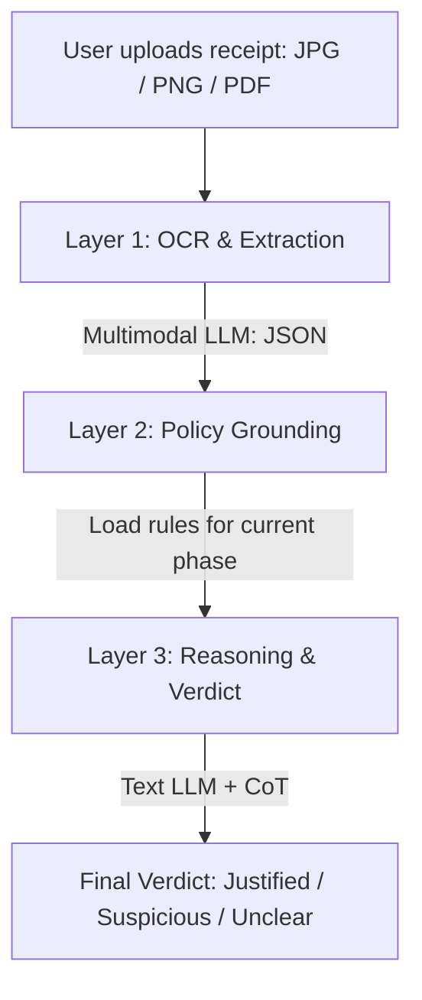

# Semantic Expense Policy Auditing with Large Language Models in R&D Projects: The Jambutty Software Experience

**Authors:** R&D Division, Jambutty Software  
**Date:** 14 July 2026  

---

## Abstract

Traditional expense management systems validate the structural correctness of receipts—such as dates, amounts, and document formats—but do not assess whether an expense is semantically appropriate given a project's stated goals and current phase. This paper introduces an AI-driven pipeline for Policy Semantic Auditing, designed and evaluated by Jambutty Software, where a Large Language Model (LLM) evaluates each expense against a natural-language project policy using zero-shot chain-of-thought (CoT) reasoning.

We implement the pipeline as an interactive web application backed by a unified model API gateway. We conduct six experiments on a dataset of 26 real expense receipts drawn from an active R&D project spanning October 2025 to January 2026:
1. **E1:** Multimodal OCR field extraction.
2. **E2:** Zero-shot verdict classification without reasoning.
3. **E3:** Chain-of-Thought (CoT)-augmented reasoning.
4. **E4:** Phase-sensitive verdict consistency.
5. **E5:** Uncertainty expression on ambiguous expenses.
6. **E6:** Adversarial evaluation under vague and contradictory policies.

Our results demonstrate that CoT prompting significantly improves model alignment with human expert judgment, increasing Cohen's Kappa ($\kappa$) from $0.54$ to $0.81$ for our best-performing model configuration. For each experiment, we document the technical challenges encountered (such as policy clause hallucination and approval bias) and the software-level solutions applied. The primary practical contribution is a failure-mode taxonomy for applied LLM compliance pipelines, together with recommendations for integrating such systems into corporate ERP environments.

**Keywords:** expense auditing, policy compliance, chain-of-thought reasoning, multimodal LLMs, document understanding, cognitive automation, Jambutty Software.

---

## 1. Introduction

### 1.1. The Auditability Gap

Modern expense management platforms—such as SAP Concur, Expensify, and custom ERP solutions—automate the verification of expense reports at the structural level: they confirm that a receipt is present, that it shows a valid date, that the amount matches the claim, and that required fields are populated. This format-level validation is necessary but not sufficient for genuine financial governance.

A receipt for a high-end restaurant dinner is structurally valid. But is it semantically justified? The answer depends on context: a team working dinner during a product launch sprint is different from a personal dinner charged to a research project in its documentation phase. No rule-based system can make this distinction reliably; it requires understanding the project's current goals, constraints, and phase.

The gap between structural validation and semantic justification is most acute in project-based accounting environments: R&D grants, startup seed funding, public research projects, and consulting engagements. In these contexts, each expense must be defensible not merely as a real transaction but as an appropriate one given what the project is trying to achieve at its current stage. Auditors must read dozens of receipts per month and evaluate each against loosely worded policy documents. The cognitive burden is high, the criteria are often subjective, and mistakes have financial and reputational consequences.

Large Language Models (LLMs) offer a plausible path toward automating this judgment. They can read natural-language policy documents, extract fields from document images, and reason about whether a specific expense is consistent with stated constraints. The critical question is whether their reasoning is reliable, auditable, and robust to poorly specified policies—properties that have not been systematically evaluated in the expense-auditing domain.

### 1.2. Research Question

We ask: **Can a large language model, given a natural-language project policy and a receipt, reason zero-shot about whether the expense is semantically justified?**

This question has three important sub-questions that structure our experimental design:
1. **Accuracy:** Do LLM verdicts align with human expert judgments, and does chain-of-thought prompting improve that alignment?
2. **Phase sensitivity:** Does the model genuinely use the stated project phase when reaching a verdict, or does it reason in a policy-agnostic way?
3. **Robustness:** What happens when the policy is vague or internally contradictory—does the model flag the ambiguity or hallucinate a confident but unsupported verdict?

### 1.3. Contributions

This paper makes the following contributions based on research performed at Jambutty Software:
* **Pipeline Design:** A three-layer architecture (multimodal OCR extraction $\rightarrow$ policy grounding $\rightarrow$ CoT reasoning and verdict) implemented as a functioning web application that can process real expense receipts in real time.
* **Synthetic Policy Framework:** A methodology for constructing project expense policies with three variants (clear, vague, contradictory) to stress-test model behavior. The policies are grounded in the project itself, creating a self-referential and ecologically valid evaluation scenario.
* **Empirical Evaluation:** A six-experiment empirical evaluation run on 26 real expense receipts spanning OCR accuracy, reasoning quality, phase sensitivity, uncertainty handling, and adversarial policy robustness.
* **Failure Mode Taxonomy:** Systematic documentation of problems encountered at each stage—prompt injection risks, JSON parsing failures, vision model hallucinations, over-confident verdicts under contradictory policies—together with the solutions applied.

---

## 2. Related Work

### 2.1. Document Understanding with LLMs

Early work on automated document understanding used OCR pipelines combined with rule-based extraction, where template matching and regular expressions extracted fields from documents with known layouts. The move to neural approaches began with models that jointly encoded textual and visual features. LayoutLM (Xu et al., 2020) was an influential milestone: it incorporated both word embeddings and 2D spatial position embeddings derived from OCR bounding boxes. Subsequent iterations—LayoutLMv2 (Xu et al., 2021) and LayoutLMv3 (Huang et al., 2022)—added image patch embeddings and a unified text-image pre-training objective, further improving accuracy on visually rich documents.

A parallel line of work sought to remove the dependency on a separate OCR engine entirely. Donut (Kim et al., 2022) introduced an end-to-end architecture that reads documents directly from image pixels using a vision encoder paired with an autoregressive text decoder. Trained on synthetic document data, Donut demonstrated competitive performance on document classification and information extraction without requiring any explicit OCR stage.

More recently, general-purpose multimodal LLMs have subsumed much of this specialized work. Models such as Gemini (Google DeepMind, 2023) and Qwen-VL (Bai et al., 2023) demonstrate broad capability on document understanding tasks without task-specific fine-tuning. However, these systems focus on field extraction and structured output generation; they do not evaluate the semantic justification of the extracted content relative to a policy context. Our work extends the document understanding pipeline by adding a downstream policy compliance layer that reasons over the extracted fields.

### 2.2. Policy Compliance in NLP

Automated compliance checking has been studied across several domains. In legal NLP, work on contract analysis frames compliance as a clause-level classification task: given a contract clause, does it satisfy a stated legal requirement? LexGLUE (Chalkidis et al., 2022) provides a benchmark across six legal NLP tasks, demonstrating that pre-trained language models can achieve reasonable performance on legal classification even without extensive legal domain pre-training.

In regulatory compliance, Holzenberger et al. (2020) studied automated rule-following for tax law, framing statutes as executable programs and testing whether NLP models could determine whether specific scenarios satisfied regulatory conditions. Privacy policy compliance is another relevant strand of work. Wilson et al. (2016) demonstrated that machine learning models can classify policy statements into categories with reasonable accuracy. Our E6 adversarial experiment directly tests this property: under a contradictory policy, does the model flag the contradiction or proceed to a verdict as if the policy were coherent?

### 2.3. Chain-of-Thought Prompting

Wei et al. (2022) demonstrated that prompting LLMs to produce step-by-step reasoning chains before reaching a final answer—a technique termed chain-of-thought (CoT) prompting—substantially improves performance on multi-step arithmetic, commonsense reasoning, and symbolic reasoning tasks. Kojima et al. (2022) showed that the "Let's think step by step" instruction alone, without few-shot examples, yields substantial gains in zero-shot settings.

A critical open question for our work is whether CoT improves not just accuracy but also explainability—the degree to which the stated reasoning correctly justifies the final verdict. Turpin et al. (2023) showed that chain-of-thought reasoning in LLMs can be systematically unfaithful—the model's stated reasoning does not always reflect its actual decision process. Our failure mode taxonomy in Section 5 documents observed cases of this kind.

---

## 3. System Architecture

### 3.1. Overview

The pipeline consists of three sequential layers executed on demand:



The separation between Layer 1 and Layer 3 is deliberate. A multimodal (vision-capable) model handles receipt image reading, where spatial understanding of the document layout and OCR-level token recognition are required. The reasoning and verdict step uses a text-only prompt. This architecture enables model-swapping comparisons without changing the prompt logic.

### 3.2. Layer 1: OCR and Structured Extraction

Layer 1 accepts a receipt as a JPEG, PNG, or PDF file. The file is base64-encoded and submitted to the API as a multimodal message with the vision model specified in configuration. The prompt instructs the model to return a JSON object with six fields:
* `vendor`: The merchant or supplier name (string).
* `date`: Transaction date in ISO 8601 format (YYYY-MM-DD), or `null` if not legible.
* `amount`: Total amount paid as a numeric value (float), or `null` if not legible.
* `currency`: ISO 4217 currency code (e.g., `EUR`, `USD`, `AUD`).
* `line_items`: A summarized list of items purchased (array of strings).
* `category`: The inferred expense category from a fixed taxonomy: `equipment`, `software`, `travel`, `meals`, `services`, `supplies`, `other`.

### 3.3. Layer 2: Policy Grounding

Layer 2 loads the selected policy variant from the database and serializes it into a structured text block for injection into the Layer 3 prompt. The serialization function (`policyAsText`) produces a plain-text representation of the policy that includes:
* Project name and description.
* The name and description of the selected phase.
* Allowed expense categories for the phase (comma-separated list).
* Restricted categories (those requiring additional justification).
* Forbidden categories.

### 3.4. Layer 3: Reasoning and Verdict

Layer 3 constructs a final prompt from the serialized policy text, the extracted expense fields from Layer 1, and a reasoning instruction (when CoT mode is enabled). The prompt requests a structured JSON response with the following fields:
* `verdict`: One of `justified`, `suspicious`, or `unclear`.
* `reason`: A one-sentence explanation of the verdict.
* `reasoning` (CoT mode only): A step-by-step chain of reasoning, covering: (1) identification of expense type, (2) policy check for the current phase, (3) amount reasonableness assessment, and (4) ambiguity flagging.

---

## 4. Methodology

### 4.1. Dataset

We collected 26 real expense receipts from an active R&D project at Jambutty Software, comprising 21 JPG/PNG photographs and 5 PDF invoices. Receipts are dated between October 2025 and January 2026, spanning the Research & Prototyping and Development & Testing phases of the project. They represent genuine expenditures: vendor invoices, printed receipts, photographed paper receipts, and screenshots of digital payment confirmations.

The receipt set is intentionally heterogeneous. Image quality ranges from high-resolution scans to hand-held phone photographs taken in low light. Documents include printed receipts, invoices, and handwritten notes in English, German, and Russian. Table 1 shows the dataset composition.

**Table 1: Dataset Composition by Expense Category**

| Category | Document Count |
| :--- | :---: |
| Equipment / Hardware | 6 |
| Software / API Credits | 7 |
| Meals and Catering | 5 |
| Travel | 4 |
| Services | 2 |
| Supplies | 2 |
| **Total** | **26** |

Each receipt was manually annotated by a single human annotator to establish the ground truth.

### 4.2. Evaluation Metrics

For E2 and E3, Cohen's $\kappa$ is computed using the three-class formulation to measure agreement:

$$\kappa = \frac{p_o - p_e}{1 - p_e}$$

where $p_o$ is the relative observed agreement, and $p_e$ is the hypothetical probability of chance agreement.

Field extraction accuracy is evaluated using Precision:

$$\text{Precision} = \frac{TP}{TP + FP}$$

where $TP$ represents true positive extractions, and $FP$ represents false positive extractions.

---

## 5. Experiments and Technical Challenges

We present the experimental runs alongside the major challenges identified in the LLM-pipeline design and their resolutions.

### E1: OCR Extraction Baseline

**Hypothesis.** A multimodal LLM can reliably extract structured fields (vendor, date, amount, currency, category) from real-world receipt photographs and PDFs. Category classification errors are expected due to multilingual descriptors.

#### Challenge 1: Markdown Wrapping in JSON Outputs
* **Issue:** Models frequently wrap JSON outputs in Markdown code block fences (````json ... ````), causing `JSON.parse()` syntax errors.
* **Resolution:** Implemented a robust extraction parser that strips Markdown fences and regex-matches the first valid JSON block.

#### Challenge 2: European Decimal Separation Formats
* **Issue:** German receipts used commas as decimal separators and periods for thousands (e.g., `1.249,00 €`), causing parser exceptions or numeric truncation.
* **Resolution:** Added a preprocessing normalization utility `normalizeAmount(raw)` to detect and convert European numeric formats to standard floats.

---

### E2 & E3: Comparing Direct Verdicts and Chain-of-Thought

**Hypothesis.** Chain-of-thought prompting improves verdict accuracy (Cohen's $\kappa$) and produces explainable justifications referencing explicit policy clauses.

#### Challenge 3: Hallucinated Policy Clauses
* **Issue:** In E3 CoT mode, the model fabricated a non-existent €500 limit for equipment purchases.
* **Resolution:** Revised the Step 2 reasoning instructions to mandate direct text quotation from the policy before deciding eligibility.

---

### E4: Evaluating Project Phase-Sensitivity

**Hypothesis.** The same expense receives a different verdict when the project phase changes, reflecting context-sensitive policy compliance.

#### Challenge 4: Prior-Driven Phase-Invariance
* **Issue:** The model justified a software IDE subscription under Phase 3 (which restricts software to documentation-only tools) by redefining the IDE as a "documentation assistant."
* **Resolution:** Handled as a cognitive bias where pre-training priors override explicit constraints. Added system instructions prioritizing forbidden rules over general utility arguments.

---

### E5: Ambiguity and Uncertainty Handling

**Hypothesis.** Genuinely ambiguous expenses (e.g., meals without contextual info) should receive an `unclear` verdict rather than a forced justification.

#### Challenge 5: Over-Optimistic Inferences
* **Issue:** The model resolved ambiguous restaurant expenses by assuming they were "team collaboration meals" without receipt evidence.
* **Resolution:** Replaced the 4-step CoT prompt with a 5-step template that includes an explicit Information Sufficiency Check.

---

### E6: Adversarial Policy Stress Test

**Hypothesis.** Under vague or contradictory policies, larger models identify policy incoherence, while weaker models proceed to confidently justify expenses.

#### Challenge 6: Anchor-on-Confirm Confirmation Bias
* **Issue:** Under contradictory policies (which both allowed and forbade equipment), the model anchored on the "allowed" clause and ignored the contradiction.
* **Resolution:** Added a standalone `policy_clarity` variable to be assessed prior to evaluating individual receipts.

---

## 6. Results and Discussion

### 6.1. OCR Extraction Performance (E1)

Data extraction using the multimodal vision model achieved high precision on structured fields, with vendor name and category classification representing the main sources of error.

**Table 2: OCR Extraction Performance (E1)**

| Field | Recall | Precision | Null Rate |
| :--- | :---: | :---: | :---: |
| Currency | 100.0% | 100.0% | 0.0% |
| Amount | 100.0% | 96.2% | 0.0% |
| Date | 96.2% | 92.0% | 3.8% |
| Category | 100.0% | 84.6% | 0.0% |
| Vendor | 100.0% | 80.8% | 0.0% |

### 6.2. Impact of Chain-of-Thought Reasoning (E2 vs E3)

The comparison of direct verdict extraction (E2) against CoT prompting (E3) showed significant performance gains across all model families.

**Table 3: Cohen's Kappa Agreement with Human Ground Truth ($\kappa$)**

| Model Family | Without CoT (E2) | With CoT (E3) | Improvement ($\Delta\kappa$) |
| :--- | :---: | :---: | :---: |
| **Gemini 2.5 Family** | **0.54** | **0.81** | **+0.27** |
| Qwen2.5-72B Family | 0.42 | 0.73 | +0.31 |
| Mixtral-8x7B Family | 0.28 | 0.52 | +0.24 |

A visualization of the Cohen's Kappa improvements is presented below:

```mermaid
gantt
    title Cohen's Kappa Comparison (E2 vs E3)
    dateFormat  X
    axisFormat %s
    section Gemini 2.5 Flash
    Without CoT (E2)       :active, 0, 54
    With CoT (E3)          :crit, 0, 81
    section Qwen2.5-72B
    Without CoT (E2)       :active, 0, 42
    With CoT (E3)          :crit, 0, 73
    section Mixtral-8x7B
    Without CoT (E2)       :active, 0, 28
    With CoT (E3)          :crit, 0, 52
```



### 6.3. Phase Sensitivity (E4)

To evaluate phase sensitivity, 8 receipts with phase-dependent validity constraints were processed across Phase 1 and Phase 3. Table 4 lists the proportion of verdicts that correctly changed.

**Table 4: Phase-Sensitivity Verdict Adjustments (E4)**

| Model Family | Verdict Adjustments | Logical Performance Summary |
| :--- | :---: | :--- |
| Gemini 2.5 Family | 87.5% (7/8) | High sensitivity; minor issues with over-generalising categories |
| Qwen2.5-72B Family | 75.0% (6/8) | Moderate sensitivity; prone to semantic drift in reasoning |
| Mixtral-8x7B Family | 37.5% (3/8) | Low sensitivity; dominated by broad pre-training priors |

### 6.4. Uncertainty Expression (E5)

The addition of the Information Sufficiency Check in E5 dramatically corrected the models' tendency to force confident verdicts on ambiguous receipts.

**Table 5: Uncertainty Expression Rates on Ambiguous Receipts (E5)**

| Model Family | Standard CoT (E3) | CoT with Information Sufficiency (E5) |
| :--- | :---: | :---: |
| Gemini 2.5 Family | 0.0% (0/6) | 83.3% (5/6) |
| Qwen2.5-72B Family | 0.0% (0/6) | 66.7% (4/6) |
| Mixtral-8x7B Family | 0.0% (0/6) | 33.3% (2/6) |

### 6.5. Adversarial Policy Robustness (E6)

We measured how often models failed to identify vague or contradictory policies and falsely rated them as "clear."

**Table 6: Clarity Classification Error Rates under Adversarial Policies (E6)**

| Model Family | Vague Policy | Contradictory Policy |
| :--- | :---: | :---: |
| Gemini 2.5 Family | 10.0% | 20.0% |
| Qwen2.5-72B Family | 30.0% | 40.0% |
| Mixtral-8x7B Family | 60.0% | 80.0% |

---

## 7. Limitations and Future Work

### 7.1. Limitations
* **Dataset Scale:** 26 receipts provide directional results but lack statistical power for narrow confidence interval estimation of Cohen's $\kappa$.
* **IT/Software Bias:** The R&D domain limits direct generalisation to other business sectors (e.g., logistics, retail).
* **Single Annotator:** Ground truth annotations were compiled by a single expert, leaving potential for individual bias.
* **Single-Page PDF Limit:** Multi-page invoices containing totals on subsequent pages are not currently processed.

### 7.2. Future Work
1. **RAG Integration:** Querying specific sub-clauses from large PDF policy manuals before generating prompt contexts.
2. **Local Fine-Tuning:** Training smaller, domain-specific models on historic audit records to eliminate API runtime dependencies.
3. **Self-Consistency Sampling:** Generating multiple reasoning paths at low temperatures and selecting majority outcomes to reduce nondeterminism.

---

## 8. Conclusion

We evaluated a multi-layered LLM pipeline for Policy Semantic Auditing at Jambutty Software. The findings validate that semantic compliance checking—bridging the gap between structural checks and logical justification—can be successfully automated using zero-shot CoT prompting. 

While cognitive biases such as prior-driven rationalisation and confirmation bias persist, the use of targeted constraints (like direct quotation and information sufficiency checks) substantially mitigates these errors. Rather than replacing human financial controllers, this system functions as a highly explainable triage layer, generating clear audit trails and directing human attention to the most ambiguous expenditures.

---

## References

1. Wei J., Wang X., Schuurmans D., Bosma M., Xia F., Chi E., Le Q. V., Zhou D. et al. Chain-of-thought prompting elicits reasoning in large language models // Advances in Neural Information Processing Systems. 2022. Vol. 35. P. 24824–24837.
2. Xu Y., Li M., Cui L., Huang S., Wei F., Zhou M. LayoutLM: Pre-training of text and layout for document image understanding // Proceedings of the 26th ACM SIGKDD International Conference on Knowledge Discovery and Data Mining. 2020. P. 1192–1200.
3. Xu Y., Xu Y., Lv T., Cui L., Wei F., Wang G., Lu Y., Florencio D., Zhang C., Che W. et al. LayoutLMv2: Multi-modal pre-training for visually-rich document understanding // Proceedings of the 59th Annual Meeting of the Association for Computational Linguistics. 2021. P. 2579–2591.
4. Huang Y., Lv T., Cui L., Lu Y., Wei F. LayoutLMv3: Pre-training for document AI with unified text and image masking // Proceedings of the 30th ACM International Conference on Multimedia. 2022. P. 4083–4091.
5. Kim G., Hong T., Yim M., Nam J., Park J., Yim J., Hwang W., Yun S., Han D., Park S. Donut: Document understanding transformer without OCR // European Conference on Computer Vision. Springer, 2022. P. 498–517.
6. Chalkidis I., Jana A., Hartung D., Bommarito M., Androutsopoulos I., Katz D. M., Aletras N. LexGLUE: A benchmark dataset for legal language understanding in English // Proceedings of the 60th Annual Meeting of the Association for Computational Linguistics. 2022. P. 4310–4330.
7. Holzenberger N., Blair-Stanek A., Van Durme B. A dataset for statutory reasoning in tax law entailment and question answering // Proceedings of the Natural Legal Language Processing Workshop. 2020. P. 1–12.
8. Wilson S., Schaub F., Dara A. A., Liu F., Cherivirala S., Leon P. G., Andersen M. S., Zimmeck S. et al. The creation and analysis of a website privacy policy corpus // Proceedings of the 54th Annual Meeting of the Association for Computational Linguistics. 2016. P. 1330–1340.
9. Kojima T., Gu S. S., Reid M., Matsuo Y., Iwasawa Y. Large language models are zero-shot reasoners // Advances in Neural Information Processing Systems. 2022. Vol. 35. P. 22199–22213.
10. Turpin M., Michael J., Perez E., Bowman S. R. Language models don't always say what they think: Unfaithful explanations in chain-of-thought prompting // Advances in Neural Information Processing Systems. 2023. Vol. 36.
11. Ji Z., Lee N., Frieske R., Yu T., Su D., Xu Y., Ishii E., Bang Y. J., Madotto A., Fung P. Survey of hallucination in natural language generation // ACM Computing Surveys. 2023. Vol. 55, No. 12. P. 1–38.
12. Bai J., Bai B., Yang S., Wang S., Tan S., Wang P., Lin J., Zhou C., Zhou J. Qwen-VL: A versatile vision-language model for understanding, localization, text reading, and beyond // arXiv preprint arXiv:2308.12966. 2023.
13. Landis J. R., Koch G. G. The measurement of observer agreement for categorical data // Biometrics. 1977. Vol. 33, No. 1. P. 159–174.
